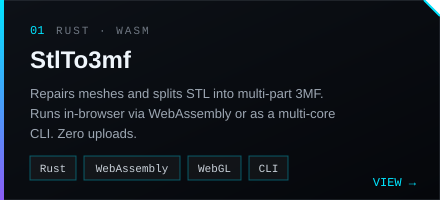
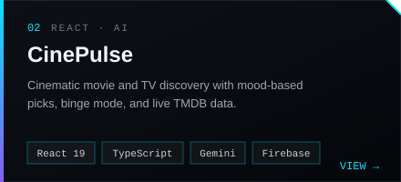
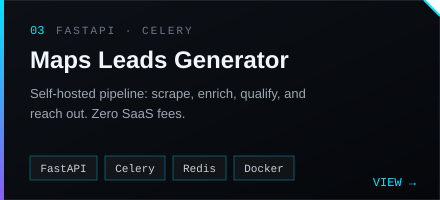
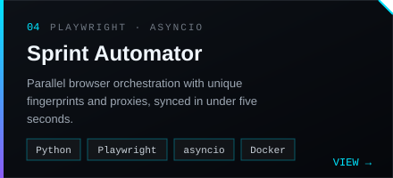

  
    

  <!-- Social & Link Badges -->
  
  
  

    
  

 

### `01` // ABOUT

> I build complete products: backend, frontend, data pipeline, deployment. I go after problems with real friction (slow workflows, messy data, tools that don't exist yet) and turn them into working software.

- **focus** → AI-assisted products · browser automation · data pipelines
- **style** → ship fast, test it, refine it
- **stack** → Rust · Python · TypeScript · React · FastAPI · Docker

 

### `02` // FEATURED

  
  
  
  

    
  👉 **[Try the live StlTo3mf converter →](https://madireis.github.io/stl-to-3mf/)**

 

### `03` // MORE BUILDS

| Icon | Project | Description |
| :---: | :--- | :--- |
| 📋 | [YouTube Transcript Copier](https://github.com/madireis/youtube-transcript-copier) | Chrome extension for one-click transcripts with batch mode & AI presets |
| 🎷 | [Jazz Bar](https://github.com/madireis/jazz-bar) | Pomodoro timer with an ambient pixel-art jazz café |
| 📺 | **StremSRC** | Stremio addon serving streaming sources, deployed on Vercel |
| 🍽️ | **MealPix Planner** | Visual-first AI meal planning app |
| 🏠 | **Taş Demir Yönetim** | Property management dashboard with Playwright E2E tests |
| 🔍 | **BattleScreen ID Tracker** | OCR pipeline that extracts and tracks player IDs |

 

### `04` // TECH STACK

  

 

### `05` // ACTIVITY & STATS

  
  
  
    
  
  

    
  

