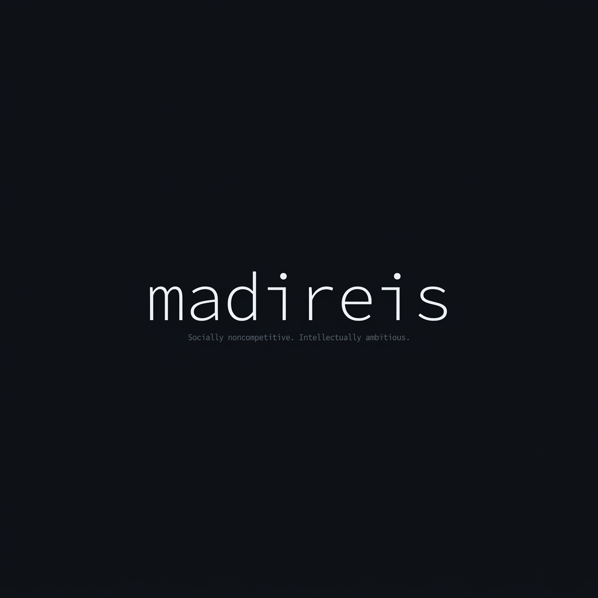

<div align="center">



<br>

# Hey. I'm Abdullah. 

### `Socially noncompetitive. Intellectually ambitious.`
### `Passive player. Solo bolo guy.`

<br>

*Computer Engineering student by day.*
*Entrepreneur & builder by obsession.*

*I don't compete with people — I compete with what I built yesterday.*

<br>

[](https://github.com/madireis)
[](mailto:abdullahmadi2005@gmail.com)

---

</div>

## `> whoami`

```js
const madireis = {
    role:       "Computer Engineering Student × Solo Entrepreneur",
    philosophy: "Build it. Ship it. Learn from it. Repeat.",
    superpower: "Turning 'what if' into working code at 3 AM",
    fuel:       ["curiosity", "insomnia", "the urge to automate everything"],
    motto:      "I'd rather build 10 things that fail than dream about 1 thing that might work."
};
```

I love trying things. I love creating things. I don't wait for the perfect idea — I build, break, learn, and move. Every project below is a scar from a lesson or a trophy from a win. Either way, it shipped.

---

## 🏗️ What I've Built

<table>
<tr>
<td width="50%" valign="top">

### 🎬 CinePulse
**Premium Movie & TV Discovery Platform**

A cinematic streaming experience with binge-mode auto-play, AI-powered recommendations via Gemini, and real-time analytics.

`React 19` `TypeScript` `Tailwind CSS 4` `TMDB API` `Firebase` `Google GenAI` `Framer Motion` `Express`

</td>
<td width="50%" valign="top">

### 🗺️ Maps Leads Generator
**Full-Stack Lead Generation SaaS**

Industrial-grade pipeline: scrape business data from maps → discover websites via Google Knowledge Panel → enrich → qualify → outreach via WhatsApp. Self-hosted, zero SaaS fees.

`FastAPI` `React` `PostgreSQL` `Redis` `Celery` `Selenium` `Docker` `SQLAlchemy` `Shadcn/UI`

</td>
</tr>

<tr>
<td width="50%" valign="top">

### ⚡ VeloSprint
**Parallel Browser Automation Controller**

High-performance system managing multiple independent browser instances with fingerprint masking, proxy rotation, and sub-5-second synchronized execution. WebKit engine for stealth.

`Python` `Playwright` `asyncio` `WebKit` `Docker`

</td>
<td width="50%" valign="top">

### 📺 StremSRC
**Stremio Streaming Addon**

Extracts and serves streaming sources for movies and TV series directly through Stremio. Deployed on Vercel.

`TypeScript` `Node.js` `Vercel` `Stremio SDK`

</td>
</tr>

<tr>
<td width="50%" valign="top">

### 🤖 BiruniReminder
**Discord Bot — Intelligent Reminder System**

A fully-featured Discord bot for managing reminders, schedules, and automated notifications with persistent state management.

`Python` `discord.py` `asyncio`

</td>
<td width="50%" valign="top">

### 🎮 Auto-Train Bot
**Game Automation with Computer Vision**

AFK training bot for Mount & Blade: uses OpenCV template matching to detect mobs, PyAutoGUI for input simulation, and a draggable overlay HUD for real-time monitoring.

`Python` `OpenCV` `PyAutoGUI` `Tkinter` `pynput`

</td>
</tr>

<tr>
<td width="50%" valign="top">

### 🔍 BattleScreen ID Tracker
**OCR-Powered Discord Intelligence**

Scans battle screenshots via Tesseract OCR to extract player names and IDs. Builds a persistent database with alias tracking across scans.

`Python` `discord.py` `Tesseract OCR` `Pillow` `aiohttp`

</td>
<td width="50%" valign="top">

### 🏠 Taş Demir Yönetim
**Property Management Dashboard**

Modern property management web app with Playwright E2E testing, built with a full React + TypeScript stack.

`React` `TypeScript` `Tailwind CSS` `Shadcn/UI` `Playwright` `Vitest`

</td>
</tr>

<tr>
<td width="50%" valign="top">

### 🍽️ MealPix Planner
**AI Meal Planning App**

Smart meal planning application with visual-first design, built with React and Shadcn/UI components.

`React` `TypeScript` `Tailwind CSS` `Shadcn/UI` `Vite`

</td>
<td width="50%" valign="top">

### 🌐 Henchman Overlay
**Real-Time Game Zone Overlay**

Timer management overlay with zone detection for competitive gaming. Transparent, always-on-top HUD with configurable timers.

`Python` `Tkinter` `JSON State` `Zone Detection`

</td>
</tr>
</table>

---

## 🧰 Tech Stack

<div align="center">

#### Languages


#### Frontend


#### Backend & Infrastructure


#### Automation & AI


</div>

---

## 📊 Stats

<div align="center">


<br>


</div>

---

## 💭 Philosophy

```
I build tools for problems I actually have.
I automate things that bore me.
I ship before I'm ready.
I break things on purpose to learn how they work.

I'm not here to impress anyone.
I'm here because building things is the only thing that makes the noise stop.
```

---

<div align="center">


<br><br>

*"The best time to start was yesterday. The second best time is now — with `git init`."*

<br>

**Solo bolo. Always shipping. 🚀**

</div>
